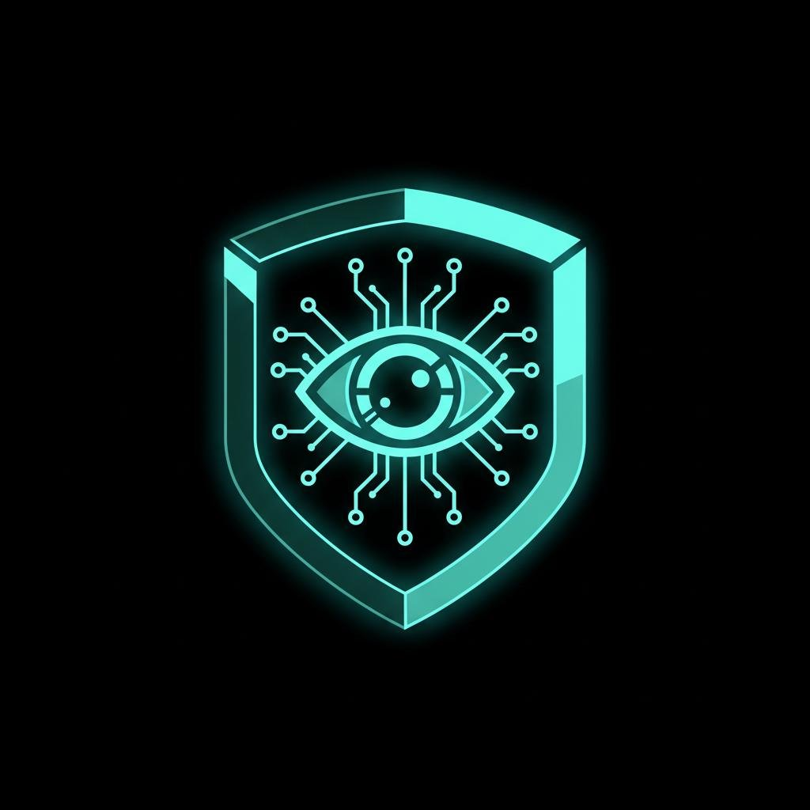
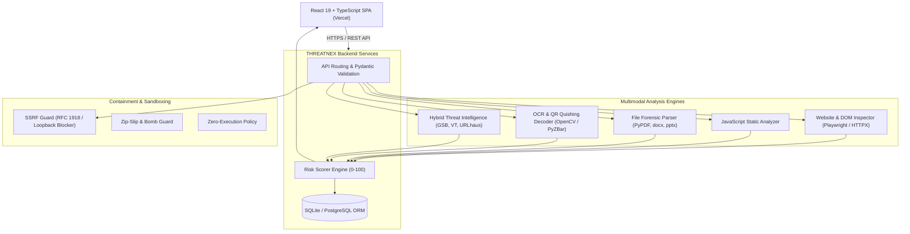

# THREATNEX 🛡️
### Next-Gen AI-Powered Multimodal Cyber Threat Intelligence & Digital Awareness Platform

  

  
  
  
  
  
  
  
  
  

  <a href="https://threatnex.vercel.app" target="_blank">
    <strong>?? Live Web App: https://threatnex.vercel.app</strong>
  </a>

---

## 🌟 Overview

**THREATNEX** is an enterprise-grade, multimodal cyber threat intelligence and interactive digital awareness platform. Built for security analysts, incident responders, and citizens, THREATNEX bridges proactive threat analysis and interactive defensive education into one cohesive, production-ready system.

It features **zero-mock analysis engines**: every URL, HTML page, JavaScript file, PDF, Word document, PowerPoint deck, CSV, image, QR code, and text snippet undergoes **real heuristic, structural, and behavioral inspection** with an explainable 0–100 risk scoring algorithm.

---

## 🎯 Key Capabilities

### 🔍 1. Multimodal Threat Inspection
* **Universal Scan Centre:** Unified drag-and-drop workspace supporting URLs, raw text, Office documents (`.docx`, `.pptx`), PDFs, images (`.png`, `.jpg`, `.jpeg`, `.webp`), CSVs, and ZIP archives.
* **Website Behavior & Source Inspector:** Playwright browser automation with resilient HTTP fallback. Inspects DOM structure, password harvesters, hidden iframes, deceptive overlays, dynamic scripts, and third-party network redirects.
* **JavaScript Static Security Engine:** AST and regex-powered detection of `eval()`, Base64 payload decompression, clipboard hijacking, form action alteration, and keylogging hooks.
* **Multimodal File Forensic Engine:**
  * **PDF:** Text extraction, embedded URI inspection, suspicious annotation checking, and embedded JavaScript detection.
  * **Word & PowerPoint:** XML parsing for macro instructions (`VBA`, `AutoOpen`), external relationship tampering, and suspicious payload markers.
  * **CSV:** Formula injection (`=cmd|`, `@SUM`, `-`, `+`) and remote DDE link detection.
  * **ZIP Archives:** Strict Zip-Slip path traversal defense (`../`), decompression ratio explosion (zip-bomb) protection, and nested executable filtering.
* **Image & Quishing Scanner:** OpenCV & computer vision QR matrix decoder, coupled with OCR text extraction for malicious payment requests, emergency lure keywords, and visual credential harvesting.

### 🧠 2. Threat Intelligence & Explainable Scoring
* **Explainable Risk Scoring (0–100):** Weighted multi-dimensional assessment covering Domain Reputation (20%), Social Engineering Indicators (20%), DOM/Script Integrity (20%), Redirect & Network Behavior (15%), Content & File Indicators (15%), and Security Headers (10%).
* **Categorized Risk Levels:**
  * `0–19`: **SAFE-LOOKING** (Green)
  * `20–39`: **LOW RISK** (Blue)
  * `40–59`: **MODERATE RISK** (Amber)
  * `60–79`: **HIGH RISK** (Orange)
  * `80–100`: **CRITICAL RISK** (Red)
* **Hybrid Intelligence Feeds:** Autonomous local heuristic detection, supplemented by optional commercial feeds: Google Safe Browsing v4, VirusTotal v3, URLhaus, and PhishTank.

### 🛡️ 3. Citizen Safety & Education Modules
* **Digital Arrest Awareness Simulation:** An interactive, multi-stage educational walkthrough exposing fake police, CBI, ED, and customs video-call extortion schemes. Explicitly reinforces that **no legal provision for "digital arrest" exists under Indian law**.
* **24 Cyber Awareness Knowledge Base:** Comprehensive guides with scam mechanics, red flags, step-by-step defense protocols, and victim recovery checklists for 24 prevalent fraud typologies (UPI scams, parcel scams, job task frauds, sextortion, SIM swap, etc.).
* **Cyber Readiness Assessment Quiz:** 60-question interactive evaluation across Beginner, Intermediate, and Advanced tiers with instant remediation feedback.
* **Forensic Export Engine:** Instant generation of print-ready, professional PDF security audit reports and structured machine-readable JSON forensic summaries.

---

## 🏛️ System Architecture

---

## 📄 License

This project is licensed under the **MIT License** — see the [LICENSE](LICENSE) file for details.
