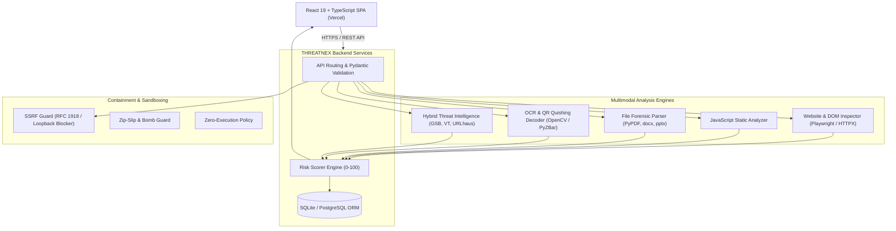

# THREATNEX 🛡️
### Next-Gen AI-Powered Multimodal Cyber Threat Intelligence & Digital Awareness Platform

<p align="center">
  
</p>

<p align="center">
  
  
  
  
  
  
  
  
  
</p>

<p align="center">
  <a href="https://frontend-theta-three-57.vercel.app" target="_blank">
    <strong>?? Live Web App: https://frontend-theta-three-57.vercel.app</strong>
  </a>
</p>

---

## 🌟 Overview

**THREATNEX** is an enterprise-grade, multimodal cyber threat intelligence and interactive digital awareness platform. Built for security analysts, incident responders, and citizens, THREATNEX bridges proactive threat analysis and interactive defensive education into one cohesive, production-ready system.

It features **zero-mock analysis engines**: every URL, HTML page, JavaScript file, PDF, Word document, PowerPoint deck, CSV, image, QR code, and text snippet undergoes **real heuristic, structural, and behavioral inspection** with an explainable 0–100 risk scoring algorithm.

---

## 🎯 Key Capabilities

### 🔍 1. Multimodal Threat Inspection
* **Universal Scan Centre:** Unified drag-and-drop workspace supporting URLs, raw text, Office documents (`.docx`, `.pptx`), PDFs, images (`.png`, `.jpg`, `.jpeg`, `.webp`), CSVs, and ZIP archives.
* **Website Behavior & Source Inspector:** Playwright browser automation with resilient HTTP fallback. Inspects DOM structure, password harvesters, hidden iframes, deceptive overlays, dynamic scripts, and third-party network redirects.
* **JavaScript Static Security Engine:** AST and regex-powered detection of `eval()`, Base64 payload decompression, clipboard hijacking, form action alteration, and keylogging hooks.
* **Multimodal File Forensic Engine:**
  * **PDF:** Text extraction, embedded URI inspection, suspicious annotation checking, and embedded JavaScript detection.
  * **Word & PowerPoint:** XML parsing for macro instructions (`VBA`, `AutoOpen`), external relationship tampering, and suspicious payload markers.
  * **CSV:** Formula injection (`=cmd|`, `@SUM`, `-`, `+`) and remote DDE link detection.
  * **ZIP Archives:** Strict Zip-Slip path traversal defense (`../`), decompression ratio explosion (zip-bomb) protection, and nested executable filtering.
* **Image & Quishing Scanner:** OpenCV & computer vision QR matrix decoder, coupled with OCR text extraction for malicious payment requests, emergency lure keywords, and visual credential harvesting.

### 🧠 2. Threat Intelligence & Explainable Scoring
* **Explainable Risk Scoring (0–100):** Weighted multi-dimensional assessment covering Domain Reputation (20%), Social Engineering Indicators (20%), DOM/Script Integrity (20%), Redirect & Network Behavior (15%), Content & File Indicators (15%), and Security Headers (10%).
* **Categorized Risk Levels:**
  * `0–19`: **SAFE-LOOKING** (Green)
  * `20–39`: **LOW RISK** (Blue)
  * `40–59`: **MODERATE RISK** (Amber)
  * `60–79`: **HIGH RISK** (Orange)
  * `80–100`: **CRITICAL RISK** (Red)
* **Hybrid Intelligence Feeds:** Autonomous local heuristic detection, supplemented by optional commercial feeds: Google Safe Browsing v4, VirusTotal v3, URLhaus, and PhishTank.

### 🛡️ 3. Citizen Safety & Education Modules
* **Digital Arrest Awareness Simulation:** An interactive, multi-stage educational walkthrough exposing fake police, CBI, ED, and customs video-call extortion schemes. Explicitly reinforces that **no legal provision for "digital arrest" exists under Indian law**.
* **24 Cyber Awareness Knowledge Base:** Comprehensive guides with scam mechanics, red flags, step-by-step defense protocols, and victim recovery checklists for 24 prevalent fraud typologies (UPI scams, parcel scams, job task frauds, sextortion, SIM swap, etc.).
* **Cyber Readiness Assessment Quiz:** 60-question interactive evaluation across Beginner, Intermediate, and Advanced tiers with instant remediation feedback.
* **Forensic Export Engine:** Instant generation of print-ready, professional PDF security audit reports and structured machine-readable JSON forensic summaries.

---

## 🏛️ System Architecture



---

## 🚀 Cloud Deployment Guide

THREATNEX is engineered for decoupled cloud deployment: the **React frontend on Vercel** and the **FastAPI backend on Render**.

### Step 1: Deploy Backend to Render.com

1. Sign up or log into [Render.com](https://render.com).
2. Click **New +** → **Web Service**.
3. Connect your GitHub repository: `https://github.com/Shreeskanda/threatnex`.
4. Configure the Web Service settings:
   * **Name:** `threatnex-backend`
   * **Region:** Any (e.g., Singapore or Frankfurt)
   * **Root Directory:** `backend`
   * **Runtime:** `Python 3`
   * **Build Command:** `pip install -r requirements.txt`
   * **Start Command:** `uvicorn app.main:app --host 0.0.0.0 --port $PORT`
   * **Plan:** Free
5. Under **Advanced** → **Environment Variables**, add:
   * `DATABASE_URL` = `sqlite:///./threatnex.db` (or attach a Render PostgreSQL database)
   * `DEBUG` = `false`
   * `SECRET_KEY` = `[Generate a secure random string]`
6. Click **Create Web Service**.
7. Once deployed, copy your backend URL (e.g., `https://threatnex-backend.onrender.com`).
8. Verify it works by visiting: `https://threatnex-backend.onrender.com/api/health`

*(Note: `render.yaml` is pre-configured in the repository root for automated infrastructure-as-code deployment via Render Blueprints).*

---

### Step 2: Deploy Frontend to Vercel

1. Log into [Vercel](https://vercel.com).
2. Click **Add New...** → **Project**.
3. Import your GitHub repository (`threatnex`).
4. In the **Project Configuration** screen:
   * **Framework Preset:** `Vite`
   * **Root Directory:** Click `Edit` and select `frontend`
   * **Build Command:** `npm run build`
   * **Output Directory:** `dist`
   * **Install Command:** `npm install`
5. Expand **Environment Variables** and add:
   * **Key:** `VITE_API_URL`
   * **Value:** Your Render backend URL from Step 1 (e.g., `https://threatnex-backend.onrender.com`)
6. Click **Deploy**.
7. Your high-performance, globally distributed frontend is now live on `https://your-project.vercel.app`!

---

## 💻 Local Development Quickstart

### Prerequisites
* **Python 3.12+**
* **Node.js 18+ & npm**
* **Git**

### 1. Clone the Repository
```bash
git clone https://github.com/Shreeskanda/threatnex.git
cd threatnex
```

### 2. Backend Setup
```powershell
# Navigate to backend
cd backend

# Create virtual environment (recommended)
python -m venv venv
venv\Scripts\activate   # On Linux/macOS: source venv/bin/activate

# Install dependencies
pip install -r requirements.txt

# Start FastAPI development server
python -m uvicorn app.main:app --host 127.0.0.1 --port 8000 --reload
```
Backend services are now live:
* **API Server:** http://127.0.0.1:8000
* **Swagger UI Documentation:** http://127.0.0.1:8000/docs
* **Health Check:** http://127.0.0.1:8000/api/health

### 3. Frontend Setup
```powershell
# Open a new terminal and navigate to frontend
cd frontend

# Install Node dependencies
npm install

# Start Vite dev server
npm run dev
```
Navigate your browser to **http://127.0.0.1:5173** to interact with the full THREATNEX suite.

---

## 🧪 Testing Suite

THREATNEX comes with automated end-to-end and unit tests covering API endpoints, SSRF containment, Zip-bomb heuristics, and multimodal analyzers:

```powershell
# Run backend pytest suite
cd backend
python -m pytest -v

# Run frontend build check
cd frontend
npm run build
```

---

## 🔒 Security Sandboxing & Guardrails

| Safeguard | Implementation |
|---|---|
| **SSRF Containment** | Rejects loopback (`127.0.0.1`), RFC 1918 subnets (`10.0.0.0/8`, `172.16.0.0/12`, `192.168.0.0/16`), AWS/GCP metadata (`169.254.169.254`), and local DNS names. |
| **Zero-Execution Policy** | Executables, macros, and scripts are never run on the host. Parsers inspect AST, byte signatures, and XML structures only. |
| **Archive Traversal Guard** | Prevents Zip-Slip attacks by validating canonical paths against temporary sandbox roots. |
| **Zip-Bomb Mitigation** | Enforces decompression ratio thresholds (rejecting >100:1 ratios) and limits total extracted size. |
| **Volatile Storage** | Uploaded artifacts are stored in temporary, isolated directories and automatically purged following analysis. |

---

## 🇮🇳 Official Emergency Resources (India)

* **National Cyber Crime Reporting Portal:** [https://cybercrime.gov.in](https://cybercrime.gov.in)
* **National Cyber Financial Fraud Helpline:** **1930** (24x7 Toll-Free)
* **Indian Computer Emergency Response Team (CERT-In):** [https://www.cert-in.org.in](https://www.cert-in.org.in)

> **Transparency Note:** THREATNEX is an independent cyber threat intelligence and citizen awareness project. It is not affiliated with any law enforcement agency or government ministry.

---

## 📄 License

This project is licensed under the **MIT License** — see the [LICENSE](LICENSE) file for details.
